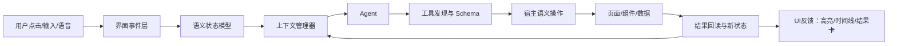

# 智能体原生时代的 UI 设计与工程组织说明

> 目标：设计一种让用户、界面和智能体可以自然协作的产品形态。用户通过点击、选择、拖拽、输入或语音表达意图；界面把这些操作转换成结构化状态；智能体读取真实状态、发现当前能力、执行语义化操作，并把结果和失败原因反馈给用户。
>
> 本文综合了两个项目的分析：Pen/pen.dev 的设计画布，以及同花顺远航版 Lumi 的客户端控制架构。

## 1. 核心判断：Agent Native UI 不是聊天框加按钮

传统软件把 UI 当作给用户看的表面，把业务逻辑藏在事件处理器里。智能体原生软件需要把 UI 同时设计成：

1. **人类界面**：让用户看得懂、点得准、知道当前状态。
2. **语义界面**：让智能体能够读取页面、对象、组件、数据和可用动作。
3. **执行界面**：让操作可以通过稳定的工具、Schema 和结果回执完成。
4. **状态界面**：让系统记录用户正在看什么、刚刚做了什么、任务完成到哪一步。

因此，UI 不再只是像素，而是一个可以被人和 Agent 共同读取、共同操作的运行时模型。



## 2. 两个项目提供的可复用模式

| 能力 | Pen/pen.dev | 同花顺 Lumi | 应抽象成的通用能力 |
|---|---|---|---|
| 用户当前对象 | `selectionManager.selectedNodes` | 当前证券、页面、组件焦点 | `SelectionContext` |
| 页面/文档状态 | 当前 `.pen`、顶层节点、组件 | `RuntimeSnapshot` | `RuntimeContext` |
| 操作对象 | 节点 ID、类型、名称、布局 | 证券、页面、组件、动作 | 语义对象模型 |
| 读取详情 | `execute` 中的 `Get(nodeId)` | `inspectPage`、`getComponentData` | `inspect` 工具 |
| 发现能力 | 固定的 `execute`、`get_app_state`、`browser` | `client_list` → `client_get_schema` | 动态能力目录 |
| 执行操作 | `Insert/Update/Move/Delete` | `client_call` | 语义化 Command |
| 状态反馈 | `agent-session-event`、执行闪烁、Agent Cursor | 新 RuntimeSnapshot、业务结果 | 事件、回执、验证 |
| 多步任务 | `spawn_agents`、脚本式 execute | `client_op_batch`、`client_exec_script` | Task Orchestrator |
| 安全边界 | 只允许经过 IPC/MCP 的文档操作 | 禁止交易、写操作串行、超时不盲重试 | 权限、幂等、验证策略 |

Pen 解决的是“被选中的设计节点是什么”。Lumi 解决的是“当前客户端正在看什么、有哪些真实能力”。合起来就是完整的 Agent Native UI：**选择状态 + 运行时快照 + 能力 Schema + 语义操作 + 结果核验**。

## 3. 用户点击如何变成 Agent 能理解的上下文

不要把鼠标坐标直接发给模型。坐标只能说明“点击了屏幕上的某个位置”，不能说明这个位置代表什么。推荐采用以下链路：

```text
点击画布/页面
  ↓
命中检测（Hit Test）
  ↓
得到稳定对象 ID
  ↓
更新 SelectionStore
  ↓
产生 selection-changed 事件
  ↓
更新 RuntimeContext
  ↓
用户发送请求时，注入当前上下文
  ↓
Agent 通过 inspect 读取详细对象
  ↓
Agent 调用 semantic command
  ↓
宿主执行并回读结果
```

上下文至少应包含：

```ts
interface SelectionContext {
  objectIds: string[];
  objects: Array<{
    id: string;
    type: string;
    name?: string;
    role?: string;
    parentId?: string;
    bounds?: { x: number; y: number; width: number; height: number };
  }>;
  source: "canvas" | "table" | "chart" | "browser" | "native";
  changedAt: number;
}

interface RuntimeContext {
  appId: string;
  workspaceId?: string;
  documentId?: string;
  route?: string;
  pageName?: string;
  currentEntity?: {
    kind: string;
    id: string;
    name?: string;
  };
  selection?: SelectionContext;
  visibleComponents?: string[];
  recentInteractions: InteractionEvent[];
  availableCapabilities: string[];
  snapshotVersion: number;
}
```

这里有一个重要规则：**上下文是状态，不是聊天记录**。用户点击了某个股票、切换了 K 线、选中了一个设计 Frame，系统都应该更新状态；Agent 下一轮读取的是当前状态，而不是依赖模型猜测用户刚才做了什么。

## 4. Lumi 的 RuntimeSnapshot 设计值得直接借鉴

同花顺宿主把状态分成多个上下文域：

- `SecurityRuntimeContext`：当前证券、代码、市场、证券类型、是否自选。
- `ViewRuntimeContext`：当前页面、页面路径、组件焦点和布局。
- `WorkspaceRuntimeContext`：自选股、用户便签、画线、颜色标记、预警规则。
- `InformationRuntimeContext`：新闻、公告、资讯和热点信号。
- `InteractionRuntimeContext`：最近点击、切换、搜索、悬停、画线和指标操作。

这个拆分比把所有内容塞进一个巨大 JSON 更容易维护。推荐项目也采用分域结构：

```text
RuntimeSnapshot
├── identity       当前用户、工作区、文档
├── navigation     当前路由、页面、Tab
├── focus          当前对象、选中组件、悬停对象
├── data           当前实体和已加载数据
├── interaction    最近操作和操作来源
├── capabilities   当前页面真实可用的工具
└── version        快照版本和时间戳
```

主进程或 Runtime Context Manager 做四件事：

1. 收集 renderer、宿主页面和数据服务的状态。
2. 展平、清洗和限制字段，避免把无关数据全部塞给模型。
3. 根据 `snapshotVersion`、页面变化和选中对象变化决定是否重新注入。
4. 将同一份快照同时提供给 UI、Agent 和调试面板。

## 5. Agent 不能猜工具，必须发现真实能力

Lumi 中最值得保留的是动态工具发现：

```text
client_list
    ↓
client_get_schema
    ↓
client_call
    ↓
结果回读
```

推荐的工具协议如下：

```ts
interface CapabilityDescriptor {
  name: string;
  title: string;
  description: string;
  scope: "read" | "write" | "navigate" | "data";
  inputSchema: JSONSchema7;
  outputSchema?: JSONSchema7;
  requiresPermission?: boolean;
  idempotency?: "safe" | "idempotent" | "non-idempotent";
  supportedRoutes?: string[];
}
```

Agent 先根据当前页面和用户意图搜索能力，再读取真实 Schema，最后调用工具。这样可以避免：

- 猜错参数名。
- 把页面名称误当成工具名称。
- 在页面切换后继续使用旧的组件索引。
- 调用了当前页面根本不存在的动作。

工具命名应采用业务语义，例如：

```text
open_security_page
inspect_page
get_component_data
list_component_actions
component_action
set_chart_period
add_to_watchlist
read_selected_node
update_selected_node
```

不要把 `click(x, y)` 作为主要业务 API。底层确实可以有坐标点击，但它应该被封装在宿主适配器内部，Agent 看到的是语义动作。

## 6. 页面控制应该分成三层

### 第一层：导航

回答“在哪里、怎么打开”。例如：打开资金流向、打开某只股票的个股页、打开设计文件中的某个 Frame。

实现方式是 `open(route, entity)`，成功后必须重新读取页面状态。

### 第二层：组件定位

回答“页面中哪个组件承载这个信息”。例如：定位财务趋势、盘口、K 线、图例或当前选中的设计组件。

实现方式是 `inspectPage()`、`inspectComponent()` 或 `Get(nodeId)`。

### 第三层：语义操作

回答“对这个组件做什么”。例如：切换周期、添加指标、加入自选、修改颜色、移动节点、替换文本。

实现方式是带 Schema 的 `componentAction()`、`Update()`、`Move()` 等命令。

这三层不能混成一个“万能点击工具”，否则 Agent 很难判断失败发生在导航、定位还是执行阶段。

## 7. 推荐的 UI 组织方式

智能体原生 UI 应让用户始终看到四件事：当前对象、当前页面、Agent 正在做什么、结果是否已验证。

### 顶部：全局身份和导航

- 当前工作区、账户和连接状态。
- 当前证券/项目/文档名称。
- 页面 Tab、最近任务和返回路径。
- Agent 连接状态和权限状态。

### 左侧：对象和结构导航

- 页面/图层/组件树。
- 当前选中对象。
- 可复用组件、收藏对象和最近访问对象。
- 支持按名称、类型、业务标签搜索。

### 中央：主工作区

- 图表、表格、设计画布或页面内容。
- 被 Agent 读取的对象可以高亮。
- Agent 正在操作的对象显示轻量光标、边框或状态点。
- 所有对象都有稳定语义 ID，但 ID 不必暴露给普通用户。

### 右侧：Agent 工作面板

Agent 面板不应只是聊天记录，建议包含：

- 输入框和语音输入。
- 当前上下文 Chips：`贵州茅台`、`个股页`、`K 线`、`当前选中组件`。
- 当前任务状态：理解中、读取页面、执行、等待确认、验证完成。
- 工具调用摘要：读取了什么、准备修改什么。
- 需要用户确认的动作。
- 结果卡和失败原因。

### 底部：任务时间线和命令区

- 最近操作：打开页面、切换周期、修改节点、添加到自选。
- 可撤销、重做和恢复。
- 当前任务的步骤、已完成步骤和待完成步骤。
- 失败时显示恢复入口，而不是只显示“操作失败”。

Pen 的浮动 Agent Spotlight、左侧工具岛、右下角缩放控件可以保留；Lumi 的上下文快照、动态工具和结果验证则应该放进右侧 Agent 面板和底部任务时间线。

## 8. 推荐代码结构

建议把代码分成“宿主、运行时、智能体、UI、能力适配器”五个边界：

```text
apps/desktop/
├─ main/
│  ├─ main.ts                    Electron 入口
│  ├─ window-manager.ts          窗口、Tab、弹窗
│  ├─ ipc-router.ts              IPC 白名单和请求路由
│  ├─ agent-runtime.ts           Agent 生命周期和会话
│  ├─ mcp-transport.ts           MCP Socket/HTTP/stdio
│  └─ permission-manager.ts      权限和用户确认
│
├─ renderer/
│  ├─ app-shell/                 布局、Tab、主题
│  ├─ canvas/                    画布、命中检测、渲染
│  ├─ selection/                 SelectionStore
│  ├─ context/                   RuntimeContextStore
│  ├─ agent-panel/               输入、任务、时间线、结果
│  ├─ layers/                    图层树/组件树
│  ├─ browser/                   浏览器节点和元素选择
│  └─ feedback/                  高亮、Agent Cursor、Toast
│
├─ runtime/
│  ├─ snapshot-builder.ts        RuntimeSnapshot 构建
│  ├─ context-policy.ts          上下文筛选和脱敏
│  ├─ interaction-log.ts         最近操作记录
│  ├─ capability-registry.ts     工具发现和 Schema
│  └─ verification.ts            结果验证
│
├─ agent/
│  ├─ session-manager.ts         会话和消息
│  ├─ prompt-assembler.ts        当前上下文注入
│  ├─ task-orchestrator.ts       多步任务、重试、分支
│  └─ subagent-manager.ts        子 Agent
│
├─ capabilities/
│  ├─ navigation.ts              页面导航
│  ├─ inspection.ts              页面/节点检查
│  ├─ data.ts                    数据读取
│  ├─ actions.ts                 业务操作
│  └─ schemas/                   动态 Schema
│
├─ adapters/
│  ├─ stock-host-adapter.ts      同花顺等宿主适配器
│  ├─ pen-document-adapter.ts    Pen/设计文档适配器
│  └─ browser-adapter.ts         浏览器/DOM 适配器
│
└─ shared/
   ├─ runtime-types.ts
   ├─ capability-types.ts
   ├─ task-types.ts
   └─ ipc-types.ts
```

主进程只负责权限、生命周期、IPC 和 Agent 连接；业务对象和页面状态由各自的宿主适配器提供；renderer 只负责展示、选择和用户输入。这样可以避免把同花顺、Pen、浏览器的逻辑混在同一个点击处理器里。

## 9. 关键接口设计

### 选择事件

```ts
interface SelectionChangedEvent {
  source: "canvas" | "page" | "browser";
  selected: SelectionContext;
  previousIds: string[];
  version: number;
  timestamp: number;
}
```

### Agent 任务

```ts
interface AgentTask {
  id: string;
  conversationId: string;
  userPrompt: string;
  startedAt: number;
  status: "understanding" | "inspecting" | "executing" | "waiting_confirmation" | "verifying" | "done" | "failed";
  contextVersion: number;
  steps: AgentStep[];
}
```

### 语义操作回执

```ts
interface OperationResult<T = unknown> {
  success: boolean;
  operationId: string;
  stage: "discover" | "inspect" | "execute" | "verify";
  result?: T;
  error?: {
    code: string;
    message: string;
    recoverable: boolean;
  };
  observedStateVersion?: number;
}
```

`success: true` 只能代表工具调用成功返回，不能直接代表业务目标完成。最终必须经过 `verify` 阶段确认，例如股票确实加入自选、K 线周期确实切换、节点属性确实变更。

## 10. Agent 执行循环

推荐的执行循环是：

```text
1. 读取当前 RuntimeSnapshot
2. 判断请求类型：导航、查看、修改、数据查询
3. 读取当前页面可用能力
4. 获取真实 Schema
5. 检查目标对象身份
6. 执行一个最小动作
7. 读取结果和新 Snapshot
8. 验证业务目标
9. 再决定下一步
```

伪代码：

```ts
async function runTask(prompt: string) {
  const before = await runtime.getSnapshot();
  const intent = await agent.classify(prompt, before);
  const capabilities = await registry.list({ route: before.route, intent });

  while (!task.done) {
    const action = await agent.planNextStep({ prompt, before, capabilities });
    const schema = await registry.getSchema(action.name);
    const input = await agent.fillAndValidate(schema, action.input);

    await permission.check(action, input);
    const result = await host.call(action.name, input);
    const after = await runtime.refresh();

    task.record(action, result, after);
    if (await verifier.check(prompt, after, result)) return task.done();
  }
}
```

页面变化后必须重新 inspect；工具返回超时或状态未知时不能直接重复写入；涉及多个写操作时要串行执行。

## 11. 安全和边界

同花顺项目中的安全设计应该保留：

- 明确禁止交易、委托、撤单、转账等高风险动作。
- 写操作必须经过权限判断。
- 页面切换后重新读取状态和 Schema。
- 外层 `success` 不等于业务完成。
- 写入超时不能自动重试，先查询实际状态。
- Agent 只能访问授权工作区、文档和当前页面。
- RuntimeSnapshot 需要脱敏和访问范围控制，避免把自选股、便签、最近操作无限期保存。
- 脚本执行必须放入受限 Worker，限制 `process`、`globalThis`、动态加载和文件访问。

## 12. 推荐的落地顺序

### 第一阶段：单对象理解

- 所有节点/组件增加稳定 ID、类型、名称和角色。
- 完成 `SelectionStore`。
- 完成 `get-runtime-context`。
- Agent 能回答“我当前选中了什么”。

### 第二阶段：读取和单步操作

- 增加 `inspect`、`get-data`、`list-actions`、`call-action`。
- UI 显示上下文 Chips 和工具调用状态。
- 每次写操作后回读目标状态。

### 第三阶段：多步任务

- 增加任务状态机和时间线。
- 实现串行批处理和受限脚本。
- 增加失败恢复、撤销和用户确认。

### 第四阶段：多宿主适配

- Pen/设计文档适配器。
- 同花顺/股票宿主适配器。
- 浏览器和 DOM 适配器。
- 统一 Agent 工具协议，差异保留在 adapter 层。

### 第五阶段：协作和可观察性

- Agent Cursor、对象高亮和操作回放。
- 工具调用日志和快照版本。
- 调试面板：当前快照、可用能力、最后一次调用、验证结果。

## 13. 最终设计原则

1. **把点击转换成语义对象，不把坐标当业务接口。**
2. **把当前页面状态做成显式 RuntimeSnapshot。**
3. **让 Agent 先发现能力，再读取 Schema，最后执行。**
4. **把导航、定位、数据读取和写操作分层。**
5. **每次写操作都要有结果回读和业务验证。**
6. **UI 同时为用户和 Agent 提供可理解的状态。**
7. **上下文要有版本、范围和生命周期。**
8. **失败必须说明发生在哪一层，以及下一步如何恢复。**
9. **高风险操作必须有明确权限和确认边界。**
10. **把宿主差异放进 Adapter，把 Agent 协议保持稳定。**

Pen 的最佳实践是“选中对象后让 Agent 读取节点结构”。Lumi 的最佳实践是“宿主持续提供运行时快照，并让 Agent 发现真实工具”。下一代智能软件应把两者合并：用户通过自然 UI 操作对象，系统把对象、页面、数据、能力和最近操作统一建模，Agent 通过可验证的语义命令完成任务，界面再把每一步状态清楚地呈现出来。
